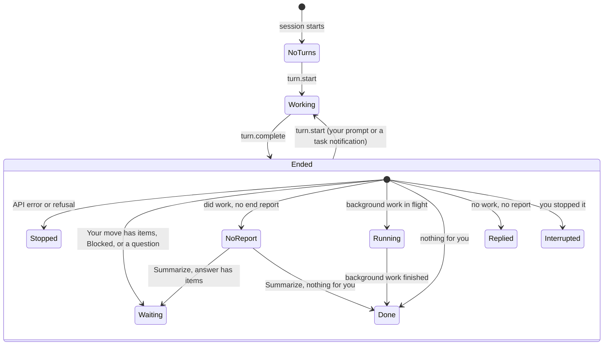

# Status pane: design

## Intent

When I come back to a session I left running, I want one glance to tell me **whether I need to
step in now, and on what**. Everything in the pane is ranked by that question.

How often this happens (14 days of transcripts, 2026-10-25): 21% of the gaps before my next
prompt are longer than 15 minutes, and 15% of turns run longer than 10 minutes, so I come back
both to finished turns and to turns still running.

One pane per session, inside that session's own window (VS Code first, the terminal too). It
lives in the dev-hooks mod.

## Goals

- A top line that names the state, in colour, with how long it has held:

  | State | Colour | When |
  |---|---|---|
  | Stopped | red | the turn ended on an API error or a refusal (`turn.complete` reason) |
  | Waiting on you | yellow | Your move has an item, or Status says Blocked, or a reply with no report ends on a question |
  | Turn ended, no end report | yellow | a turn that did work (an edit, or 10+ tool calls, the end-report-reminder rule) ended with no report |
  | Working | blue | a turn is running |
  | Running | blue | the turn ended, background work is still in flight |
  | Done | green | the turn ended and Your move says nothing |
  | Replied | dim | a turn that did no work ended with no report and no question |
  | Interrupted | dim | you stopped the turn |
  | No turns yet | dim | a new session |

  Red beats yellow beats blue beats green and dim: background work still running while Your
  move has an item shows **Waiting on you**, with the work listed under Running.

- **Which turns count:** every turn since your last typed prompt, not only the latest. Task
  notifications, CI prompts and wake-ups start turns of their own; a later turn ending "Your
  move: nothing" must not wipe an ask from the turn before, so Your move gathers the items of
  every ended turn since your last prompt, and the state is the worst of them. Typing a prompt
  starts over.

- Below it, in this order, each section hidden when it has nothing to show (except Your move):
  1. **Your move**: the end report's Your move items, or "nothing".
  2. **Doing**: the session's latest brief, clamped to two lines.
  3. **Done when**: the brief's criteria, open circles while a turn runs. Once a turn ends, tick
     them by position only when the end report's Done when has as many items as the brief, each
     reading met or not; otherwise show the report's Done when text under them, unticked. Both
     sides are free text, and a wrong tick is worse than none.
  4. **Running**: background tasks, scheduled wake-ups and CI watches, each with its age.
  5. **Changed this session**: the end report's Changed lines, then one dim line per repo this
     session committed to: "dev-hooks: 3 commits, pushed" or "not pushed". The commits come from
     this session's own `git commit` output (`[branch sha] message`) in Bash results, with the
     repo from `ci-watch.ts`'s `pushDir` (which follows `cd` and `-C`); pushes from the CI
     watch's existing push parsing. Never `git log --since`: commits land on worktree branches,
     and parallel sessions commit to the same `main`.
  6. **Not checked**: the end report's Not checked lines.
  7. A dim footer: turns so far and session length.
- The title row carries the time of the last update, so a stale pane is visible.
- **Summarize this turn** button, only in the no-end-report state. One press asks a model for the
  turn's Status and Your move and shows the answer in place of the missing report.
- The pane opens itself when a session starts where it docks beside the chat (VS Code, desktop,
  a fullscreen terminal wide enough), not inline in an ordinary terminal, where it would take
  10 to 15 rows of every session. `/session-status` opens it anywhere. (Claude Code already has
  a built-in `/status`.) Opt out with `DEV_HOOKS_STATUS_PANE=false`, like the other hooks.

Mockups: `.superpowers/brainstorm/2372219-1792925350/content/layout-combined.html` (local).

## Non-goals

- A view across several sessions. (I asked; the answer was one session.)
- Model summaries on a timer.
- Stop-hook nudges and their outcomes; they stay backstage (`/session-facts nudges` has them).
- Acting from the pane (answering questions, approving tools).

## Anti-goals

- Green while I'm needed: a pane that says Done while Your move has an item, or while a question
  is open in the chat, is worse than no pane.
- Spending tokens while nothing happens: the only model call is the button.
- A wall of text: lists are capped (Your move 5, Changed 4, Running 4, Not checked 2), each cap
  ending in "+N more".

## Where the data comes from

| Section | Source | Notes from profiling |
|---|---|---|
| State | `turn.start` / `turn.complete` events; the Stop input's `background_tasks` and `session_crons`; CI watches the module already tracks | |
| Your move, Done when (ticks), Changed, Not checked, Status | the final message (`turn.complete` text), parsed by label | the labels are new (end-report-reminder, 2.64.0), so older sessions show the no-report state |
| Doing, Done when (criteria) | the latest assistant text in the session holding both `Doing:` and `Done when:`, from `$.session.messages()` | only 1% of work turns carry a brief (a brief comes once per task), so this block is usually hidden; Doing runs median 305, p90 755 characters, hence the clamp |
| Per-repo commit lines | this session's own `git commit` / `git push` output in Bash results (`tool.call`, after `next`) | the session facts list only Edit/Write targets: they saw 8 of the 21 files this session changed, so they are not used for counts |
| Footer | `$.session.turns()`, session start | |

Labels parse the way `hook_helpers.end_report_missing` matches them: bold or plain, a heading
form, "this turn"/"this session" suffixes, "What I changed" for Changed. A section's value runs
from its label to the next label, keeping bullets as items.

## States

## Approaches considered

1. **Inside the dev-hooks mod (chosen).** It already holds the session facts, the CI watches,
   the Stop orchestration (which sees `background_tasks`) and the turn events. The pane is one
   more `ui.render` hook. Parsing and state derivation go in a pure `hooks/status-pane.ts`,
   unit-tested directly; everything that touches `$` stays in `register.tsx`, as with
   `ci-watch.ts` and `nudge-outcomes.ts`.
2. **A separate mod.** It would rebuild the CI-watch state, read the facts across a plugin
   boundary and install separately. Rejected.
3. **A model summary on a timer** (my first idea). It costs tokens while nothing changes and can
   disagree with Claude's own end report. Rejected; kept only as the button for turns without a
   report.

## Decided

- Name: pane id and command `session-status`, title "Session status".
- Times: show both, "since 09:05 (12 min)". A one-minute clock tick redraws the open pane; it
  costs no tokens.
- State persists in `$.state` (survives a reload, not a new session), declared in
  `types/index.d.ts`.
- The summarize answer uses `$.model.fork` (reads the session's own transcript through the prompt
  cache) with a fixed prompt asking for a Status line and Your move items only.
- Surfaces: terminal and vscode drawn and tested; desktop and mobile get whatever the same tree
  draws there.
- Settled after the builder review, as Claude's calls for me to check: Your move gathers every
  turn since my last typed prompt; a turn that did no work shows Replied (or Waiting on you when
  it ends on a question), never the no-report state; commit lines per repo from this session's
  own git output; auto-open only where the pane docks, plus an opt-out; Done when ticks by
  position only when the counts match; Stopped (red) and Interrupted (dim) for errors and
  interrupts.

## Left to the builder

- Exact copy of labels and empty-section text, within the mockups' tone.
- How the label parser is shared with `hook_helpers.end_report_missing` (a TS mirror pinned by a
  parity test, as `test_nudge_parity.py` does for the review needles).
- Whether a question open in the chat (AskUserQuestion, a permission prompt) can be detected and
  shown as Waiting on you; if the API exposes it cheaply, do it.
