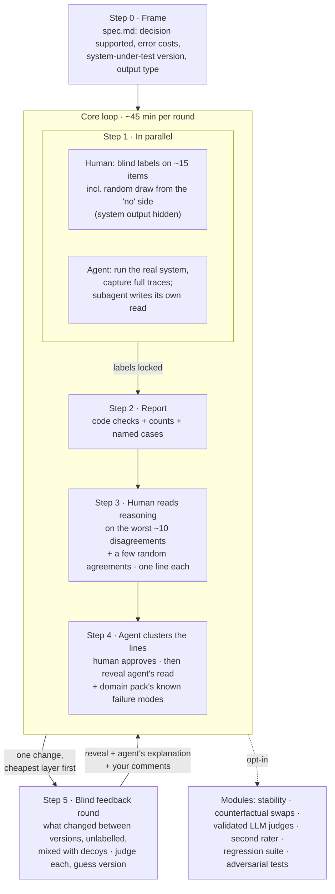

# Proposal: a human-first evals workflow for AI agents

*v4, 2026-09-24. A generic workflow for setting up evals on any agent or LLM system: agents that act, generators that write, and judges that score, rank or classify. Everything domain-specific lives in swappable domain packs (section 4). A five-critic review of an earlier draft shaped the design; see the [changelog](#changelog).*

**TL;DR:**

- **Human first, agent in parallel, reveal after.** You write your judgment of each item *before* seeing the system's output or my read of it. Meanwhile I run the system and write my own read. We compare only after your labels are locked. Every label records whether its author had already seen model output.
- **Sample where the system said no.** Any system that filters, ranks, routes or refuses hides its false negatives, because nobody downstream ever sees them. Every labelling round includes a random draw from the rejected side.
- **You read the reasoning; I organise.** You read reasoning traces and write one plain line about the first thing that went wrong. I cluster those lines into failure modes, and you approve them. Reasoning is for *finding* errors, never for proving a decision was fair.
- **After every change, a blind feedback round.** You see what changed between two versions without being told which is which, judge each case, and only then get my explanation.
- **Counts and names while samples are small.** Statistics only print once the pooled labels clear stated minimums.
- **A 45-minute core loop, everything else opt-in.** Build it as a spike first; turn it into a plugin (`eval-kit`) once the loop has worked on two real systems.

Companion doc: [syllabus-annotated.md](syllabus-annotated.md), the research this builds on.

---

## 0. Your take first (5 minutes)

This applies the workflow's own rule to this proposal. Answer these **in this file, under each question**, before you read on. I'll compare your answers with section 6 afterwards.

1. Which two or three systems do you expect to point this at in the next six months?
   > *your answer*
2. For the first one, what does it output (an action, text, a score, a rank, a yes/no), and who acts on that output?
   > *your answer*
3. Which error costs more there: a good item rejected or missed, or a bad one let through?
   > *your answer*
4. How many minutes per round will you realistically give this, in a busy week?
   > *your answer*
5. When you read an LLM's reasoning, what makes you distrust its conclusion?
   > *your answer*

---

## 1. What the course skills cover, and what's missing

The [course skills](https://github.com/ai-evals-course/evals-skills) by Shankar & Husain cover error discovery (a review app, diverse sampling, and turning your notes into failure modes), writing LLM judges, validating judges against human labels, synthetic data, and RAG. The workflow routes to them for all of that. Five gaps are why it needs its own layer:

| Gap | Why it matters | What this workflow adds |
|---|---|---|
| **Anchoring.** The course has the agent suggest failures once you've annotated about 10 traces, so your later labels are made after seeing suggestions | When labels also *measure* the system, seeing LLM suggestions shifts annotators' labels and inflates the system's measured performance ([Schroeder et al. 2025](https://arxiv.org/abs/2507.15821): 410 annotators, preregistered) | Blind-first labels, a `saw_model_output` flag on every label, and headline numbers computed only from blind labels |
| **Invisible false negatives.** Error analysis reads the traces the system produced | A filter's worst mistake, the good item it rejected, gets no downstream attention, so no one reviews it | Every round includes a random draw from the rejected, low-ranked or not-escalated side |
| **Scorers and rankers.** The course is built around pass/fail per failure mode | Many agents output scores, ranks or triage decisions, and the question is whether the right items end up on top | Decision-level metrics: missed positives by name, inversions, and flip counts |
| **Reasoning traces.** The course shows reasoning in the review app but gives no guidance on reading it | Models often leave out what actually drove an answer ([Turpin et al.](https://arxiv.org/abs/2305.04388); [Anthropic](https://www.anthropic.com/research/reasoning-models-dont-say-think), measured on hint tasks) | A reading checklist that treats reasoning as a place to find errors, plus counterfactual tests for unstated drivers |
| **Feedback after a change.** The course compares versions on metrics | Metrics miss what error analysis hasn't found yet, and the person who designed a change is biased toward it | A blind before/after round in which your judgment comes before my explanation |

**Licensing.** The course repo has **no license** (GitHub reports none), so attribution alone doesn't let us copy it. We depend on it instead, pinned to a tested commit, and describe it in our own words. If you'd rather vendor it, ask them to add a license first. I haven't opened that issue, because it would be a public post in your name.

---

## 2. Principles

1. **Human first, with every label's source recorded.** The labels that measure a system are made before anyone sees its output for that item, and each one carries `saw_model_output: true/false`. Labels made after exposure are still useful for error discovery. They're reported separately, as *concordance*.
2. **In parallel, then reveal.** While you label, I run the system and a separate subagent writes its own read of the traces. That subagent has no access to your labels, and its read counts as a second opinion that shares the model's blind spots, not as an independent check. You see it after your first ~10 labels are locked.
3. **Sample where the failures hide.** Mix cluster representatives, random picks, items near the decision boundary, and a random draw from the side the system rejected.
4. **Evaluate the real system.** Re-runs go through the production prompt path and input handling, not a clone. If production runs once per item, judge single runs, and use repeat runs only to measure stability.
5. **The agent organises, the human decides.** I cluster, count, sample and point at odd cases. You approve every failure mode and every accepted suggestion.
6. **Report what the sample can support.** Per round, report counts and named items. Rank correlations, κ and confidence intervals appear only on pooled labels above stated minimums, and the report refuses to print them below those minimums.
7. **The core fits in a busy week.** About 45 minutes per round; every other module is opt-in.
8. **Sensitive data never enters a repo.** It lives under an absolute path outside git, with pseudonymous IDs, a delete-by date, and a refusal to write inside a repository.

---

## 3. The workflow

### Step 0: Frame (≈10 min)

I draft `spec.md` from whatever exists (prompt, tools, docs, sample outputs), and you correct it. It pins down five things:

- **The decision the system supports.** For example: "which 20 items go forward", "whether to escalate", "what the agent does next".
- **Its output type.** An *action* (agent), *text* (generator), or a *judgment* (score, rank, classification). The type picks the default metrics and the domain pack.
- **Error costs.** Which is worse: a false positive or a false negative?
- **The system-under-test identity.** Prompt or rubric version, model snapshot, reasoning settings, and input format.
- **Who owns the quality bar.** One person whose labels count as gold. That's the course's "benevolent dictator", and for your uses it's you.

### Step 1: Blind labels and agent run, in parallel (≈15 min for you)

**You** see only the *input* for each item: the task, document, profile or conversation so far. You record the judgment you'd want the system to make, on the *same scale* as the system's decision (binary where the decision is binary), plus one line on why. Labels are append-only. If you change your mind later, that's a new line, and the original stays.

Sampling for the ~15 items:

- a few cluster representatives, which is how the course samples;
- a few random picks;
- a few near the decision boundary;
- **a random few from the rejected side**, taken from a full run whose results you haven't seen.

**I** meanwhile run the real system on the whole sample and capture full traces: inputs, tool calls and results, reasoning or thinking, and the final output. I run the cheap code checks, and a separate subagent writes its read of the traces into a file you don't open yet.

### Step 2: Report (automatic)

A one-page Markdown report:

- **Missed positives, by name.** Items you'd have accepted that the system rejected or ranked low, with the part of the trace that sank them. The random draw from the rejected side gets its own line. One hit there is a loud signal; zero hits is only weak reassurance.
- **False positives, by name.** Items you'd have rejected that the system passed.
- **Inversions.** For rankers: pairs where an item you rejected outranks one you accepted.
- **Code checks on 100% of outputs.** The output parses, required fields are present, length limits hold, and forbidden content or actions are absent. The domain pack supplies the specific checks.
- **Grounding check.** Each factual claim in the output or reasoning is matched against the input and tool results by plain string matching, and unmatched claims are flagged `[NOT FOUND]`.

### Step 3: Read the reasoning (≈15 min)

A Markdown file with one section per case: the ~10 worst disagreements plus 2–3 random agreements. Random agreements catch cases where the system was right for the wrong reason. Each section shows your label, the system's output, and the full reasoning, with grounding flags inline. For agents it also shows the tool-call sequence, with the first failing step highlighted.

You write **one plain line per case** about the first thing that went wrong, from the point of view of the person affected. For example: "recommended an option the tool result said was unavailable", not "hallucination".

The checklist at the top of the file:

1. **Grounded?** Every claim appears in the input or a tool result.
2. **Consistent?** The reasoning's conclusion matches the output. "Clearly unsuitable" followed by a high score fails this.
3. **On-spec?** It applies the criteria in `spec.md`, including the exclusions.
4. **Right reason?** On agreements: would the output survive if an irrelevant but impressive signal were removed?
5. **Unstated driver?** Something that seems to move the output without being mentioned. Note it as a hypothesis for the counterfactual module; a trace alone can't settle it.
6. **First failure** (agents): which step went wrong first? Later errors are usually knock-on effects.

### Step 4: Cluster, then reveal (≈10 min)

I cluster your lines into named, binary failure modes with counts, and you approve, rename or split them. **Only then** do two things get revealed:

- the subagent's sealed read, whose suggestions you accept or dismiss one at a time;
- the domain pack's known failure modes, used as a gap check. The course treats published taxonomies the same way, because seeing them earlier primes what you notice.

Approved modes go into `taxonomy.md`, which carries over between rounds.

### Step 5: Blind feedback round (after each change, ≈10 min)

I make **one** change at a time, to the cheapest layer that could fix the top failure mode, in this order:

1. prompt or rubric wording
2. structure or weights
3. tool design
4. input formatting or harness
5. model

Both versions run on fresh items, and you get:

- every item whose *decision* changed between versions, plus a few random unchanged items as decoys;
- for noisy systems, a change counts only if the mean across 3 runs moved, so run-to-run noise isn't mistaken for a change;
- items you didn't label in Step 1, where possible, so you aren't re-checking your own earlier answers;
- no version labels. You judge each item on the system's own decision scale (for a filter: "should this pass: yes/no") and guess which version is the new one. The guess measures how often the blinding broke.

Then the reveal: which version did what, my explanation of the change, and your comments. Your judgments count as fresh blind labels. If you prefer the old version, that isn't a veto of the metrics. It's a new failure-mode hypothesis, and it goes back to Step 3.

### 3.1 Pooled statistics

Blind labels accumulate across rounds and, where it makes sense, across systems of the same domain. Version comparisons hold out a whole round at a time. The report prints a statistic only once its minimum is met:

| Statistic | Minimum pooled blind labels | Form |
|---|---|---|
| Recall or precision at the decision boundary | ≥ 30 in the class concerned | Wilson CI, weighted by inverse sampling probability (the rejected-side draw is sampled at a different rate) |
| Version A vs version B | ≥ 30 items that could flip | McNemar test on each item's decision |
| Rank correlation (Kendall τ-b), PR-AUC | ≥ 80 labels | Sampling-weighted |
| Judge TPR/TNR | ≥ 30 Pass *and* ≥ 30 Fail | Course `validate-evaluator` |
| Agreement between two humans | ≥ 40 overlapping items | Weighted κ or Krippendorff's α |

When two humans disagree, they disagree about the goal. The fix is a conversation between them, not rewording the prompt.

### 3.2 Opt-in modules

| Module | Use when | Notes |
|---|---|---|
| **Stability** | The output feeds a threshold or ranking | 5 runs per item. Report the share of items whose decision flips between runs, and name them |
| **Counterfactual swaps** | Decisions about people, or any case where irrelevant features might drive the output | Paired variants differing in one feature. Report flip counts and the smallest effect the test could have detected. **Never report "passed"** |
| **LLM judges** | A failure mode that code can't check | Course `write-judge-prompt`, then `validate-evaluator`, one judge per failure mode |
| **Second rater** | Someone else's judgment also matters | Their disagreements with you are worth reading before any κ |
| **Regression suite** | The system is changing regularly | Approved failure modes become test cases; course L6 |
| **Adversarial tests** | Untrusted input reaches a system that can act | Course L7; promptfoo red-teaming |
| **Agent trajectory checks** | Multi-step agents | A transition-failure matrix (last good state × first failure) and step-level checks on tool choice and arguments |

---

## 4. Domain packs

Everything domain-specific lives in a pack with a documented interface. A pack supplies:

- **the output type and default decision metrics;**
- **code checks** for that output format;
- **known failure modes**, revealed only after the human's own taxonomy exists;
- **counterfactual swap lists**, if the domain involves decisions about people or other sensitive features;
- **legal and data notes;**
- **an adapter** that turns the system's logs into the workflow's trace format.

**Example packs, one per output type.** Each is a few lines here; the full pack goes in `references/`.

| Pack | Output type | Decision metrics | Typical code checks | Known failure seeds (literature) | Counterfactuals? |
|---|---|---|---|---|---|
| **Tool-using agent** (e.g. support, ops) | Actions | Task success on the final state, pass^k, first-failure transition matrix | Forbidden tool not called, arguments valid, required confirmation present | Wrong tool, stale state, missed handoff, acts on injected instructions | Rarely |
| **Generator** (e.g. writing, summaries, email) | Text | Failure-mode pass rates | Format, length, required sections, no leaked internals | Unsupported claims, omissions, tone off-brief, instructions ignored | Only if audience matters |
| **Judge / ranker** (e.g. triage, lead scoring, candidate or grant evaluation) | Scores, ranks, labels | Missed positives by name, inversions, flip rate at the threshold | Scores extractable and in range, fields present | Prestige or brand over-weighting, halo across criteria (pairwise ρ > 0.7 is a warning), clumping on one anchor band, formatting sensitivity | **Yes** when items are people: swap one feature, count flips, never report "passed". Decisions about people can be legally high-risk (e.g. EU AI Act Annex III for hiring). |

Swapping packs changes these rows, not the loop.

---

## 5. What to build, in order

1. **Spike (now).** Two small things, run on the first real system you pick:
   - `scorer_report.py`, a uv inline script covering the Step 2 report and the minimum-n refusals;
   - a Markdown template for Steps 1 and 3.

   No review app and no plugin yet.
2. **After two rounds on real systems:** the `eval-kit` plugin in this marketplace. It can't be named `evals`, because the course plugin already uses that name and both would claim the `evals:` namespace.
   - `eval-kit:evals-workflow` runs the loop, loads domain packs through `references/domain-pack.md` (a synthetic example pack is validated by pytest), checks that the course plugin is installed at the tested commit, and degrades clearly if it isn't.
   - `eval-kit:blind-review` is a **maintained** review-app template: a stdlib server, append-only labels, a server-side reveal gate that serves output only once the item is labelled, no localStorage, the reasoning checklist, and the blind feedback screen. Tested with pytest.
   - `eval-kit:scorer-evals` is the report script plus its metric guide.
   - The three example packs ship with the plugin, kept generic. Anything specific to one organisation's process goes in a private pack outside this repo.

---

## 6. Open questions

1. **The first system.** Which one, what goes in, what comes out, and who acts on it? This decides the first domain pack and adapter.
2. **Where the traces come from.** Does the system keep its full output, including reasoning, or only extracted fields?
3. **Scripted runs.** Can I run the system from a script (needed for repeat runs and version comparisons), or only through a UI?
4. **The license issue.** Should I open one on ai-evals-course/evals-skills?

---

## Changelog

- **v4.** Moved into dev-hooks `plans/evals/`. Cut the candidate-evaluation pack down to one row of an example table, next to tool-using-agent and generator packs. The decision scale in the review interface is a per-system setting (binary by default, tiers or per-criterion yes/no optional).
- **v3.** Made generic. Removed the organisation-specific process, and the domain-pack interface is spelled out. Added agent-specific pieces: first-failure reading, trajectory checks, and adversarial and regression modules.
- **v2.** Revised after a five-critic review. Headline numbers use blind labels only, with labels flagged by exposure. Added the rejected-side draw. Per-round stats became counts and names, with pooled stats behind minimum-n gates. Cut to a 45-minute core. The blind feedback round became a decision diff with decoys and a version guess. The sealed hash became an isolated subagent. Renamed the plugin to avoid the `evals` clash, and made the review app a maintained template.
- **v1.** First draft.
