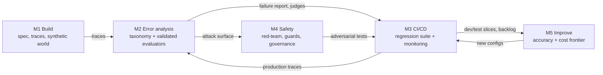

# AI Evals for Engineers & PMs: annotated syllabus

The original syllabus (`dev-hooks/plugins/evals-course-syllabus.md`, copied from the [course page](https://maven.com/parlance-labs/evals)) names each technique in a phrase. This version explains each one briefly, gives the numbers practitioners use, and links a source. The last section lists what the course leaves out, with proposed extra lectures.

Researched 2026-09-24. **[U]** marks claims that couldn't be checked against a primary source. Several terms ("SPEC.md", "smoke report", "reset-and-replay", "upgrade drill", "freeze and read test once") look like the course's own vocabulary. No public definition was found for them, so they are described here from general practice.

The course has since been turned into a book: Shankar & Husain, *Evals for AI Engineers* (O'Reilly). The practical companion is Hamel's [evals FAQ](https://hamel.dev/blog/posts/evals-faq/), which most of the numbers below come from.

---

## Module 1: Building agents (L1–L3)

### L1: Foundations

- **SPEC.md.** A written contract for the agent. It covers what the agent may do, who it acts for, each tool's inputs, outputs, preconditions and side effects, which actions are high-risk (irreversible, spend money, touch personal data), and when it must hand over to a human. Evals need this as their reference: you can't call a trace a failure without a definition of a pass. Hamel says to test each tool call on four things: the tool chosen, its arguments, its result, and the resulting system state. A tool contract written in those terms becomes a set of checks. ([FAQ: agentic workflows](https://hamel.dev/blog/posts/evals-faq/how-do-i-evaluate-agentic-workflows.html)) The SPEC.md template itself is [U]; it looks like course packaging.
- **The Three Gulfs.** These come from Shankar et al.'s DocWrangler paper ([arXiv 2504.14764](https://arxiv.org/abs/2504.14764)), which adapts Norman's gulfs of execution and evaluation.
  - *Comprehension* (you ↔ your data): you can't read every input and output, so you don't know how the system actually behaves.
  - *Specification* (you ↔ the pipeline): you only work out what you want once you've seen outputs, and then you still have to put it into the prompt.
  - *Generalization* (data ↔ pipeline): even a good prompt fails on unusual inputs.

  The classic mistake is treating a specification failure as a generalization failure, for example switching models when the prompt never asked for the behaviour. In the course's loop, error analysis (Analyze) closes comprehension, prompt and spec fixes close specification, and Measure → Improve works on generalization. That mapping is from course notes [U].
- **Permissions in code, not the prompt.** "Never refund over $500" in a prompt is a request that the model or an injected document can override. A check in the tool handler, or a read-only database grant, is a guarantee. OWASP [LLM06 Excessive Agency](https://genai.owasp.org/llmrisk/llm062025-excessive-agency/) says to enforce authorization downstream and give tools least privilege. Log denied actions as their own events, so you can count attempts separately from successes.
- **OpenAI Agents SDK.** Its building blocks are `Agent` (instructions plus tools), `Runner` (the loop), function tools with auto-generated schemas, handoffs, guardrails (input, output and tool), sessions, human-in-the-loop hooks, and built-in tracing. Tracing captures prompts and tool I/O by default (`trace_include_sensitive_data=True`), which matters for privacy. ([docs](https://openai.github.io/openai-agents-python/tracing/))

### L2: Designing for evaluability

- **Trace data model.** One trace per request or session, made of nested spans: agent turns, model calls (model, parameters, messages, tokens, latency), tool calls (name, arguments, result, error), guardrail and permission decisions including denials, and handoffs. Each span carries a prompt version, for example a hash of the rendered system prompt, so a failure can be tied to the exact prompt that produced it. Give every request a session ID and a sequence position so the path can be rebuilt. ([FAQ: multi-turn traces](https://hamel.dev/blog/posts/evals-faq/how-do-i-debug-multi-turn-conversation-traces.html))
- **OpenTelemetry GenAI conventions.** These are the vendor-neutral attribute names: `gen_ai.operation.name` (`invoke_agent`, `execute_tool`, `chat`…), `gen_ai.provider.name`, `gen_ai.conversation.id`. Message content is opt-in because it carries personal data. The conventions are still marked *Development*, so pin the version you use. ([spec](https://github.com/open-telemetry/semantic-conventions-genai/blob/main/docs/gen-ai/gen-ai-agent-spans.md))
- **Self-hosted Langfuse + ClickHouse.** Langfuse v3 runs a web container and a worker, with Postgres for transactional data, ClickHouse for traces and scores, Redis for queues and S3-compatible storage for raw events. ClickHouse is there because "count failure code X across a million spans" is an analytical query that Postgres handles badly. ([self-hosting](https://langfuse.com/self-hosting))
- **Why instrument before traffic.** Error analysis runs on traces. Traffic you didn't trace is evidence you've lost, and tracing added later tends to miss the fields root-cause analysis needs: tool arguments, prompt versions, denials.

### L3: Synthetic data and scenarios

- **A deterministic fictional world.** Seed a fake but consistent environment (users, orders, policies, a `facts.yaml` of ground truth) so every scenario has a checkable answer and runs the same way twice. τ-bench is the published model: it grades the *final database state* against an annotated goal state, not the transcript text. ([arXiv 2406.12045](https://arxiv.org/abs/2406.12045))
- **Dimension/tuple generation.**
  1. Pick three failure-driving dimensions, such as persona, intent and clarity.
  2. Write about 20 tuples by hand with a domain expert.
  3. Have an LLM produce more tuples.
  4. Turn each tuple into a natural-language query with a *separate* prompt. One-step generation produces repetitive phrasing.
  5. Run the queries and aim for about 100 diverse traces.
- **User simulators, and their limits.** An LLM plays the user, with a hidden goal. Simulated users are too cooperative and too uniform, which inflates agent success rates, and more capable models do *not* make better simulators ([arXiv 2603.11245](https://arxiv.org/abs/2603.11245): 31 simulators compared against 451 humans). Success rates move by up to 9 percentage points depending on which model plays the user ([arXiv 2601.17087](https://arxiv.org/abs/2601.17087)). Hamel prefers **N-1 testing**: replay the first N-1 turns of a real conversation and generate only the last one.
- **Smoke report** [U]. A quick run over the scenario set to confirm that the world, the harness and the tracing all work before any real eval.

---

## Module 2: Error analysis (L4–L5)

### L4: Finding failures

- **Open coding.** A domain expert reads whole traces and writes free-text notes, with no preset categories. Note the *first upstream failure* only, because later errors are usually knock-on effects and counting them inflates the wrong categories. Write the note from the user's point of view ("recommended a closed store"), not as a diagnosis ("retrieval bug").
- **Axial coding.** Group the notes into a small set of named, **binary** failure modes and count them. Both terms come from grounded theory (Glaser & Strauss; Strauss & Corbin).
- **Saturation.** Stop when new traces stop producing new failure modes. Hamel's numbers: review at least 30 traces yourself before asking an LLM to cluster anything; work from a pool of about 100 diverse traces; then review 10–20 a week, plus 100 or more fresh ones every 2–4 weeks.
- **Why "let the agent evaluate everything" fails.** An LLM clustering traces unaided drops domain failures into generic buckets ("hallucination", "unhelpful"). On the TRAIL benchmark, the best model found only **11%** of the errors in agent traces ([arXiv 2505.08638](https://arxiv.org/abs/2505.08638)). The Lenny's article makes the same point from experience: agents spot contradictions between a tool result and the answer, but miss failures that need product judgment, such as a missed sales objection.
- **Criteria drift.** You need criteria to grade outputs, but grading outputs changes your criteria ([Shankar et al., "Who Validates the Validators?"](https://arxiv.org/abs/2404.12272)). Expect to relabel early traces once your taxonomy settles.
- **Published taxonomies, compared only afterwards.** MAST: 14 multi-agent failure modes in 3 categories, from more than 1,600 traces, with human κ = 0.88 ([arXiv 2503.13657](https://arxiv.org/abs/2503.13657)). Also TRAIL, and Microsoft's red-team taxonomy of agentic failures (v2, June 2026). Use them to find gaps in your own taxonomy, never as a starting point, because they prime you to see their categories.
- **Transition-failure matrices** (not in the syllabus, but Hamel's standard tool for multi-step agents). Rows are the last state that succeeded; columns are the state where the first failure happened. The biggest cell shows where to debug first. ([FAQ](https://hamel.dev/blog/posts/evals-faq/how-do-i-evaluate-agentic-workflows.html))

### L5: Measuring with evaluators

- **One binary evaluator per failure mode.** Use code for anything objective: schema, tool choice, arguments, final state, whether a forbidden action was attempted. Use an LLM judge only when the check needs interpretation, and try hard to reduce it to code first; a lot of "subjective" failures turn out to be a keyword list.
- **Judge prompt: four parts.** (1) one criterion, (2) explicit Pass and Fail definitions, (3) few-shot examples from the *train* split, including a borderline case, and (4) structured output with the critique *before* the verdict.
- **Splits.** Train 10–20% (the few-shot source), dev 40–45% (iterate on this), test 40–45% (run once). Aim for 30–50 Pass *and* 30–50 Fail examples across dev and test, balanced even if the real distribution is skewed. "Freeze and read test once" means that any prompt change made after seeing test results turns the test set into a second dev set.
- **TPR/TNR, not accuracy.** A judge that always says Pass gets 95% accuracy on a 95%-pass dataset and catches nothing. Target over 90% on both; the minimum is 80%. Cohen's κ is valid for judge-vs-gold too, but TPR/TNR is more useful there because it feeds the prevalence correction; κ's natural home is agreement *between humans*.
- **Correcting prevalence (Rogan-Gladen).** A judge's raw pass rate is biased by its own errors. The correction is θ̂ = (p_obs + TNR − 1)/(TPR + TNR − 1), clipped to [0, 1], and it is only valid when TPR + TNR > 1. Put a bootstrap CI around it. The course's [`judgy`](https://github.com/ai-evals-course/judgy) library does both. The course skill says improving TPR narrows the CI more than improving TNR does [U: depends on prevalence].
- **Judge biases.** Pairwise judges show position bias, verbosity bias and self-preference ([MT-Bench, arXiv 2306.05685](https://arxiv.org/abs/2306.05685); [self-recognition, arXiv 2404.13076](https://arxiv.org/abs/2404.13076)). Binary single-output judging avoids position bias entirely. Where self-preference matters, use a judge from a different model family.
- **Subsystems.**
  - *Retrieval*: Recall@k for first-pass retrieval; Precision@k, MRR or NDCG for reranking.
  - *Grounding*: is the context relevant, is the answer faithful to it, and does it answer the question?
  - *Handoffs*: was one triggered when it should have been, and not when it shouldn't, and did enough context go with it?

**Homework:** 60+ labelled traces → 5–8 binary failure modes, each with a definition, an example and a boundary.

---

## Module 3: CI/CD (L6)

- **Failures become test cases.** Each case has an input (a turn or a scripted conversation), an expected result (an assertion on the output, a tool call or the final state), and an initial state (fixtures, mocked APIs). Anthropic recommends starting with 20–50 cases drawn from real failures, and keeping *capability* evals (low pass rate, meant to be climbed) separate from *regression* evals (near 100%, meant to be held) ([Anthropic, "Demystifying evals"](https://www.anthropic.com/engineering/demystifying-evals-for-ai-agents)).
- **Cost tiers.** (1) Deterministic assertions on every commit, (2) mocked integration with real model calls and stubbed tools, (3) full agent evals with live tools and simulated users, run nightly or before release.
- **pass@k vs pass^k.** pass@k is the chance that at least one of k tries succeeds, which suits capability when a verifier can pick the winner. pass^k is the chance that *all* k succeed, which measures reliability. With p = 0.75 per try, pass^3 ≈ 0.42. In τ-bench, GPT-4o's retail pass^8 was below 25% ([arXiv 2406.12045](https://arxiv.org/abs/2406.12045)). Run each case 3–8 times.
- **Reset-and-replay** [U]. Every trial starts from an identical, freshly seeded environment, because state shared between trials causes correlated failures. "Replay" means re-running a captured production trace against a new build, with tool responses mocked.
- **Noise.** At p = 0.8 and n = 50, the 95% CI is about ±11 points, so 50 cases can't detect a 5-point regression. Compare versions on the *same* items with a paired test ([Miller, "Adding Error Bars to Evals"](https://arxiv.org/abs/2411.00640)).
- **GitHub Actions gate.** Tier 1 runs on every PR and fails on any regression-case failure or when a threshold drops. [promptfoo's action](https://www.promptfoo.dev/docs/integrations/github-action/) posts before/after results on PRs that change prompts. Pin model snapshots and keep keys in secrets.
- **Monitoring after deploy.** Code checks run on 100% of traffic. *Frozen* (versioned) judges run on a random sample; if the judge changes, you can't tell judge drift from product drift. Dashboards show corrected prevalence with CIs, and alerts fire when the CI crosses a line, not on a single point. Keep a human reviewing 10–20 traces a week.

---

## Module 4: Security, safety and governance (L7)

- **[OWASP Top 10 for Agentic Applications 2026](https://genai.owasp.org/resource/owasp-top-10-for-agentic-applications-for-2026/)** (Dec 2025): ASI01 Goal Hijack, ASI02 Tool Misuse, ASI03 Identity & Privilege Abuse, ASI04 Agentic Supply Chain, ASI05 Unexpected Code Execution, ASI06 Memory & Context Poisoning, ASI07 Insecure Inter-Agent Communication, ASI08 Cascading Failures, ASI09 Human-Agent Trust Exploitation, ASI10 Rogue Agents. This is a different list from the OWASP Top 10 for *LLM Applications*.
- **No reliable injection detector.** A detector that catches 95% fails against an attacker who only needs the other 5%. The dependable fix is architectural. Simon Willison's [lethal trifecta](https://simonwillison.net/2025/Jun/16/the-lethal-trifecta/) is private data, untrusted content and a way to send data out; remove one of the three. The six design patterns in [arXiv 2506.08837](https://arxiv.org/abs/2506.08837) are Action-Selector, Plan-Then-Execute, Map-Reduce, Dual LLM, Code-Then-Execute and Context-Minimization. [CaMeL](https://arxiv.org/abs/2503.18813) makes Dual LLM provably secure at a small cost in capability: 77% of AgentDojo tasks against 84% undefended.
- **promptfoo red-teaming.** *Plugins* generate probes for one class of vulnerability; *strategies* wrap those probes in an attack method (jailbreak iteration, multi-turn crescendo, encodings). The workflow is `promptfoo redteam init / run / report`. Every successful attack becomes a failing test in the Module 3 suite.
- **Guards.** Input guards (injection and PII classifiers, as defence in depth), output guards (schema, redaction, policy judges), and tool guards (allowlists, argument validation, per-tool credentials, spend limits, egress limits). **Human approval for irreversible actions**, with the approval screen showing the real parameters. Approval fatigue is a risk of its own (ASI09).
- **[NIST AI RMF](https://www.nist.gov/itl/ai-risk-management-framework)** has four functions: Govern, Map, Measure and Manage; evals live in Measure. The [Generative AI Profile (AI 600-1)](https://nvlpubs.nist.gov/nistpubs/ai/NIST.AI.600-1.pdf) lists 12 risks, including confabulation and harmful bias. Both are voluntary.
- **EU AI Act.** AI used to recruit, filter applications, or *evaluate candidates* is **high-risk** under [Annex III point 4](https://artificialintelligenceact.eu/annex/3/).
  - *Providers* must meet Art. 9–15 (risk management, data governance including bias examination, documentation, logging, transparency, human oversight, accuracy and robustness), plus a quality management system, conformity assessment, registration and post-market monitoring.
  - *Deployers* (Art. 26) must assign competent human oversight, keep logs for at least 6 months, and inform the candidates and workers affected. Art. 86 gives a right to an explanation.
  - Since 2 Feb 2025, emotion recognition at work is banned.
  - The **Digital Omnibus** (Regulation (EU) 2026/1744, in force 27 Jul 2026) moved Annex III high-risk obligations from 2 Aug 2026 to **2 Dec 2027** [U: from law-firm summaries, the Official Journal text wasn't read].
  - A logged, bias-tested eval programme is therefore a legal artefact for this domain.

---

## Module 5: Improving agents (L8–L9)

### L8: Accuracy and joint optimization

- **Pareto frontier.** Plot each configuration's accuracy (corrected pass rate) against its cost per task, and keep only the configurations nothing beats on both. A change counts only if it pushes the frontier outward. Change one axis at a time and compare with paired tests.
- **Fix at the cheapest layer**, in this order: prompt (specification failures) → tool design (names, descriptions, structured errors the agent can act on) → harness (retries, validation, context management) → model or weights. Each step down is more expensive and harder to undo.
- **Manual first, then automate.** [GEPA](https://arxiv.org/abs/2507.19457) has an LLM reflect in plain language on failed trajectories, propose prompt edits, and keep a Pareto set of candidate prompts. It beats GRPO (RL) with up to 35× fewer rollouts and beats MIPROv2 by more than 10%, and it ships as `dspy.GEPA`. A *bounded* improve-loop has a fixed budget, a test split the optimizer never sees, a stop-after-N-rounds-without-gain rule, and a human reviewing diffs before anything is promoted.
- **Reward hacking.** An optimizer maximizes the judge, not the goal: it learns the judge's style, hard-codes eval inputs, or games the rubric. Mitigations are a held-out test set, several independent graders, re-checking judge-vs-human agreement *on the optimized outputs*, and reading transcripts. Don't rely on reading the model's reasoning to catch it: in Anthropic's experiments, models exploited reward hacks more than 99% of the time but mentioned them in their chain of thought less than 2% of the time ([Anthropic](https://www.anthropic.com/research/reasoning-models-dont-say-think)).

### L9: Cost

- **Profile first.** In agent loops, input tokens grow roughly quadratically with the number of turns. The usual culprits are history growth, retrieval depth, and repeated tool schemas. Measure cost per *successful* task.
- **Prompt caching.** Put stable content first and variable content last. On Anthropic, a cache read costs 0.1× the input price and a write 1.25× (5-minute cache) or 2× (1-hour cache). Changing tool definitions or thinking settings invalidates the cache. Check `cache_read_input_tokens` to confirm you're getting hits. ([docs](https://platform.claude.com/docs/en/build-with-claude/prompt-caching))
- **Routing and cascades.** [FrugalGPT](https://arxiv.org/abs/2305.05176) sends each query to a cheap model first and escalates when a scorer isn't confident. It matched GPT-4 at up to 98% lower cost. Pick the threshold on a dev split of *your own* labelled data and report the result on the test split, because routers don't transfer between domains.
- **The weights track.** Use distillation, SFT or RL only when prompt search has plateaued and the remaining failures are real capability limits. Fine-tuned models also re-incur the whole eval burden every time the base model changes.
- **Upgrade drill** [U]. Keep each frontier configuration as a versioned config. When a new model ships, re-run the full suite (including pass^k), re-validate the judges if the judge model changed, redraw the frontier, and decide what to deploy, keep or retire.

---

## Bonus: interview prep

Likely questions:

- How do you evaluate an agent with no ground truth?
- How do you validate a judge? (splits, TPR/TNR, corrected prevalence)
- Why binary instead of 1–5?
- pass@k vs pass^k?
- How many cases do you need to detect a 5-point regression?
- How do you handle a flaky eval?
- How are guardrails different from evals?
- Walk through open and axial coding.
- What is criteria drift?
- How would you stop injection in an email agent? (the trifecta)
- When do you prompt, when do you fine-tune, and when do you switch models?

---

## Gaps: what the syllabus leaves out

The course is built around one product type: a support agent with binary failure modes and a system of record. Below is what a practitioner outside that shape would still need, ordered by how much it matters for agents that *judge or rank* things, such as candidate evaluation.

| # | Gap | Why it matters | Where to start |
|---|---|---|---|
| 1 | **Evaluating scorers and rankers, not just pass/fail** | Many LLM systems output a score or a ranking: candidate screening, lead scoring, triage. Binary failure modes don't measure "is the ordering right?". You need rank agreement with an expert (Spearman/Kendall), shortlist precision@k, recall of the expert's picks, and score calibration. | [MT-Bench judge analysis](https://arxiv.org/abs/2306.05685); see the workflow proposal |
| 2 | **Stability and run-to-run variance** | pass^k covers agents that act. A scorer has the same problem: the same candidate scored 3 times can land in different shortlist bands. It is never measured. | [Miller, arXiv 2411.00640](https://arxiv.org/abs/2411.00640) |
| 3 | **Fairness and counterfactual bias audits** | Recruitment AI is EU high-risk. NYC Local Law 144 requires published impact ratios but sets no threshold; the 0.8 "four-fifths" flag is the EEOC Uniform Guidelines' rule of thumb (29 CFR 1607.4D). Swapping a name while keeping the evidence the same is the standard test, and the syllabus doesn't cover it. | [NYC LL144 rules](https://rules.cityofnewyork.us/rule/automated-employment-decision-tools-2/); [Wilson & Caliskan 2024](https://arxiv.org/abs/2407.20371) (cite the race results only: a code bug inverted its gender headline, [corrected Aug 2026](https://github.com/kyrawilson/Resume-Screening-Bias)) |
| 4 | **Reading reasoning traces, and how far to trust them** | Reasoning models often don't state what actually drove their answer: Claude 3.7 mentioned a hint it used 25% of the time, R1 39%. Reasoning is useful for *finding* errors (a grounding failure, reasoning that contradicts the score) but is not a faithful account of *why* the model decided. | [Anthropic, "Reasoning models don't always say what they think"](https://www.anthropic.com/research/reasoning-models-dont-say-think) |
| 5 | **Keeping human judgment unanchored** | The course covers the review interface, but not the *order* of human and model judgment. A reviewer who sees the model's score first anchors on it (automation bias). Collect independent human labels *before* revealing the model's output, and keep the first take even if the reviewer changes their mind. | Automation-bias literature; see the workflow proposal |
| 6 | **Inter-rater agreement and adjudication** | Mentioned only in passing. With two reviewers (e.g. you and a second domain expert), you need κ on a shared set and an adjudication step before the labels count as gold. | [Landis & Koch bands; McHugh 2012](https://pmc.ncbi.nlm.nih.gov/articles/PMC3900052/) |
| 7 | **Statistical power for version comparisons** | CIs cover a single estimate, not "is rubric v3 better than v2?". That needs paired designs, a minimum detectable effect and multiple-comparison control. | [arXiv 2411.00640](https://arxiv.org/abs/2411.00640) |
| 8 | **Validating the user simulator** | L3 builds simulators but never checks them against real users. | [arXiv 2603.11245](https://arxiv.org/abs/2603.11245) |
| 9 | **Trace privacy and retention** | Traces hold personal data (CVs, conversations). Redaction, access, GDPR retention and the AI Act's 6-month log rule all interact. | OTel content opt-in; GDPR Art. 5 & 22 |
| 10 | **Trajectory-level agent checks** | τ-bench grades only the final state. Tool-selection accuracy, argument correctness, redundant steps and recovery after errors need step-level matchers. | [agentevals](https://github.com/langchain-ai/agentevals); [arXiv 2503.16416](https://arxiv.org/abs/2503.16416) |
| 11 | **Online experiments** | A/B testing agent changes against business metrics, which is Hamel's "level 3". | [Hamel, "Your AI product needs evals"](https://hamel.dev/blog/posts/evals/) |

### Proposed extra lectures

- **L5b: Evaluating scorers and rankers.** Rank agreement, shortlist precision@k and recall, calibration curves, test-retest stability, and turning a scorer's failures into binary modes (for example "prestige over-score", "seniority mismatch") so the Module 2 machinery still applies. *Homework:* score 40 items three times, report Spearman against the expert, per-item score spread, and precision@10.
- **L7b: Fairness audits for high-stakes decisions.** Counterfactual swaps (name, gender, nationality cues, CV formatting), impact ratios, what the AI Act requires of deployers and providers in employment, and documentation that counts as evidence.
- **L4b: Human review ops.** Blind-first labeling, two-reviewer κ, adjudication, re-review after criteria drift, and how to read reasoning traces without taking them at face value.
